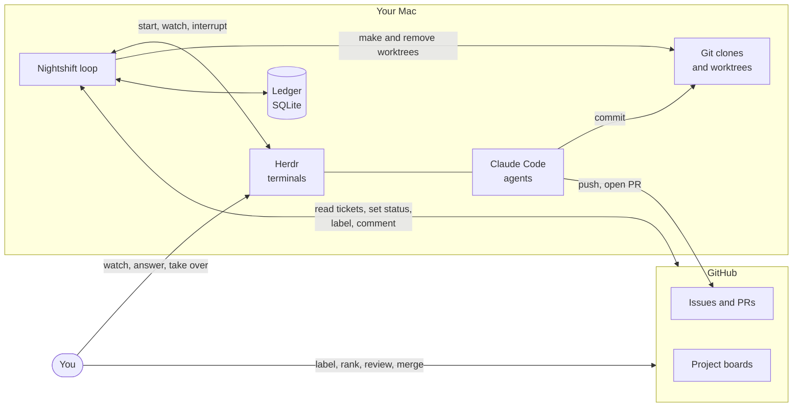
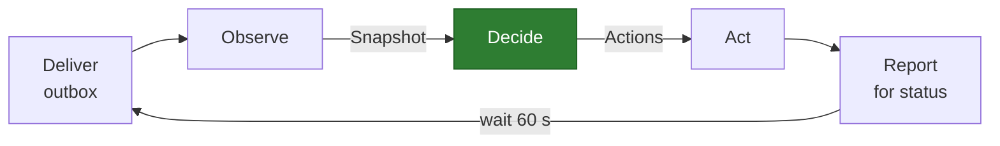
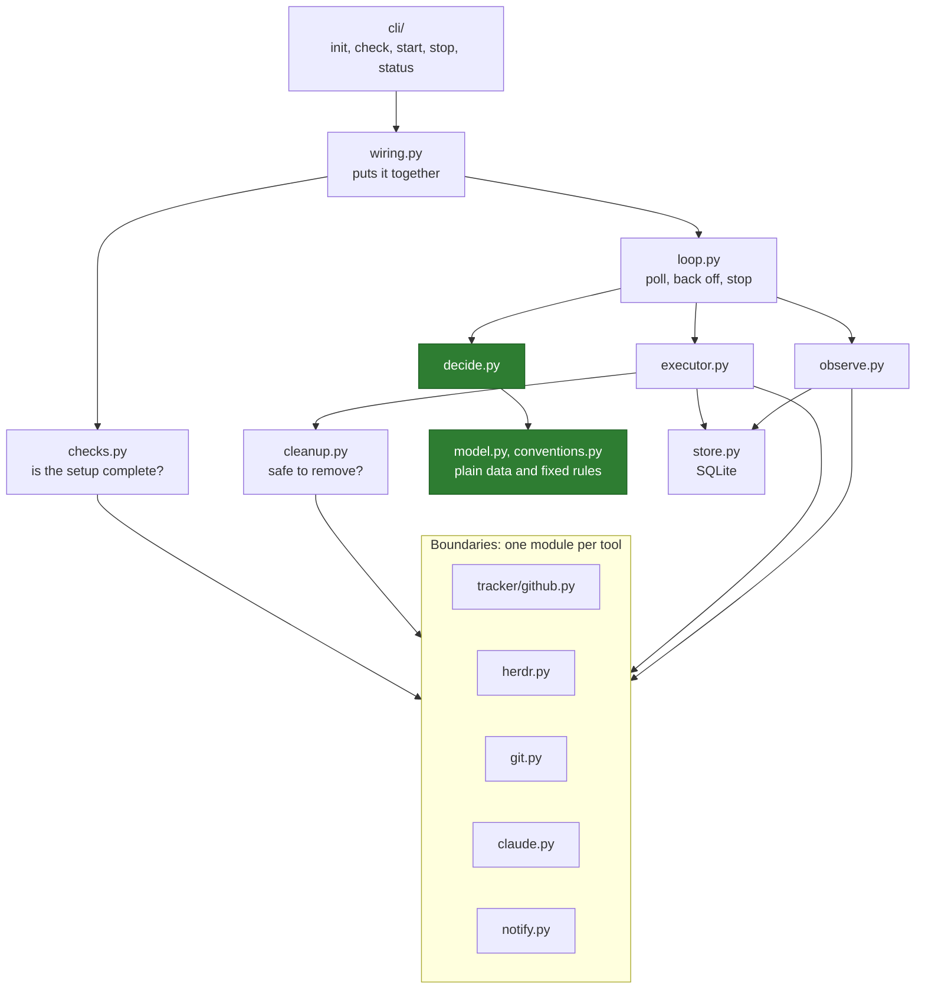
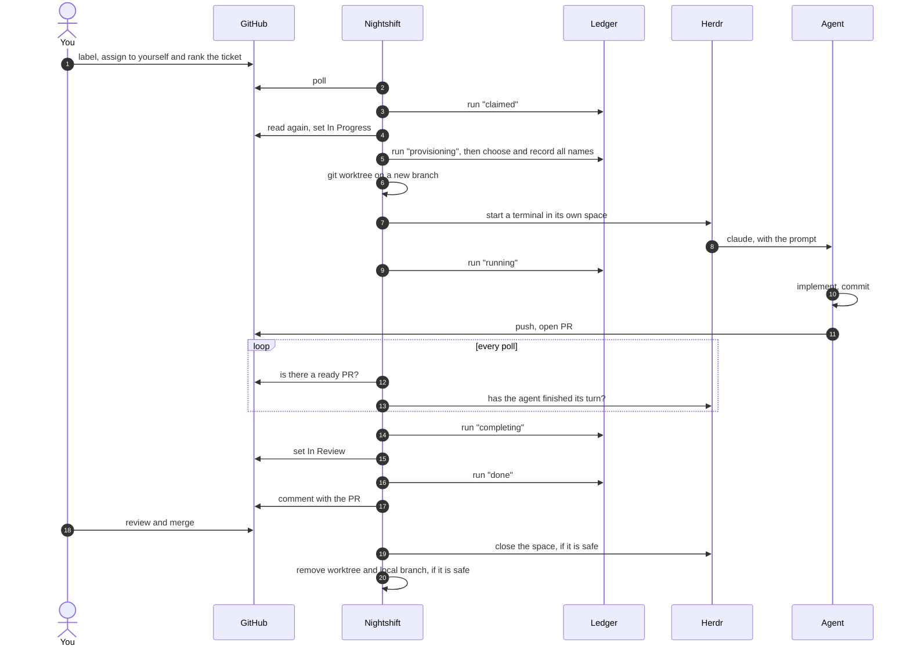
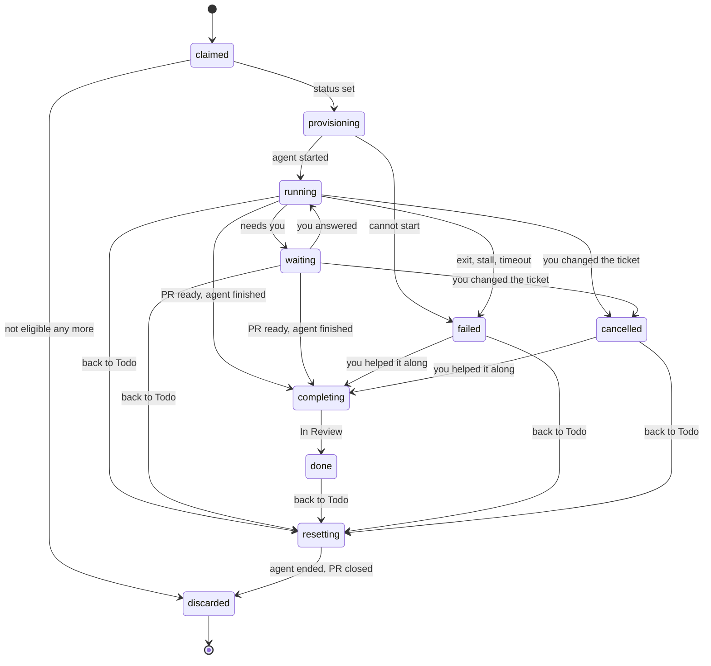
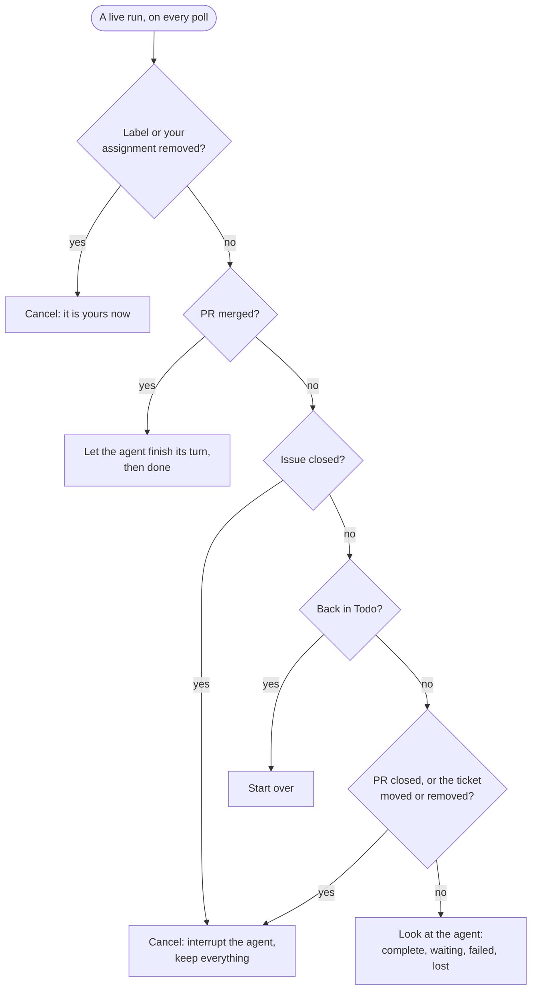
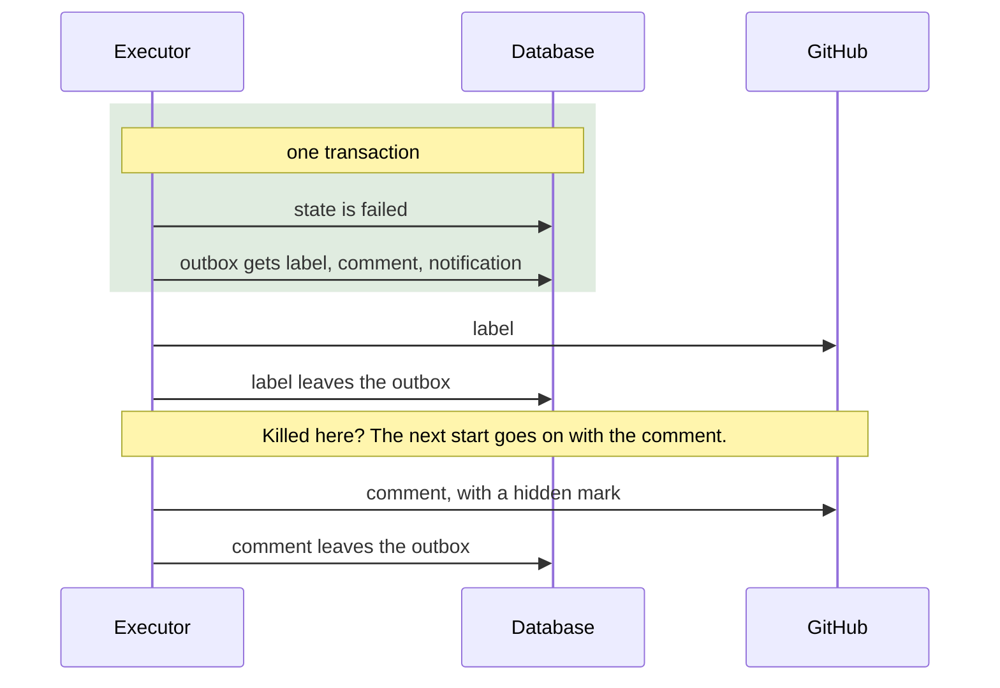
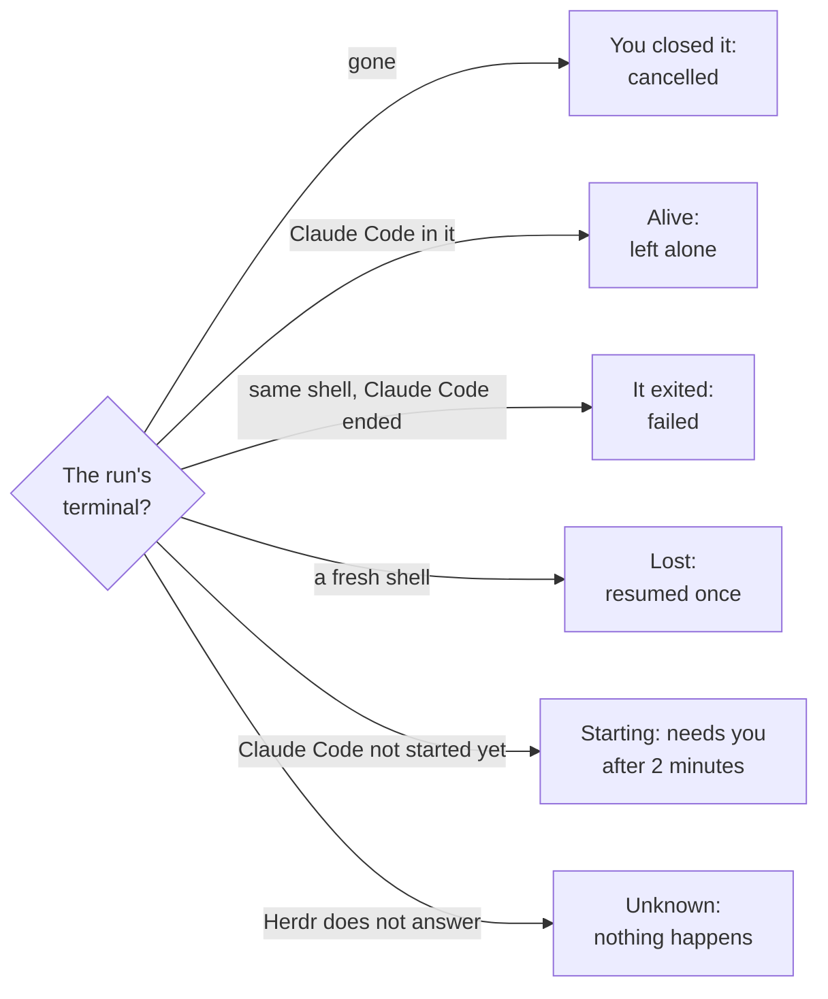
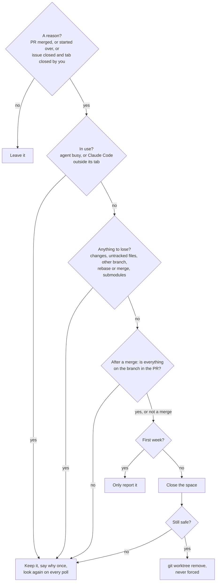

# Nightshift: design

How Nightshift is built, at a high level. Read this first; it takes about ten minutes.

- *What* it must do is in the [product spec](specs/2026-11-21-initial.md). Codes such as FR-13
  refer to it.
- *Why* things were chosen is in the [decision log](decisions.md).

## 1. The big picture

Nightshift is one loop on your Mac. It has no server and no web interface. It connects tools that
already exist, and each of them stays the authority on its own part.

| Part | What it decides |
|------|-----------------|
| GitHub | What is to be done, in which order, and what you changed |
| Git | What work exists locally |
| Herdr and Claude Code | Whether an agent is alive, and what it is doing |
| The database | Only what Nightshift itself started and must remember |

**The database is the ledger, the others are the truth.** Nightshift can be killed at any moment,
because on the next poll it compares its ledger with the world again.

## 2. One poll: observe, decide, act

Every 60 seconds, the same steps run:

- **Observe** (`observe.py`) reads GitHub, Herdr, Claude Code's transcripts and the database into
  one `Snapshot` of plain data.
- **Decide** (`decide.py`) is a pure function from a snapshot to a list of actions. It reads and
  writes nothing, so the rules are tested with plain data.
- **Act** (`executor.py`) carries the actions out. It reads a ticket again right before it changes
  its status or starts it over. Every step is safe to repeat.

Existing runs are decided before new tickets are picked.

A problem stays as small as possible:

| What fails | What happens |
|------------|--------------|
| One action | Recorded, shown by `status`, decided again on the next poll |
| One board or repo | Skipped; the others go on |
| Herdr or Claude Code | Nothing new is picked; agents are left alone |
| GitHub | The poll ends, and the next ones come less often: up to 15 minutes apart, or when a rate limit resets |
| A bug in one poll | Logged; the loop goes on |

**Nothing is concluded from what could not be read.** An unreadable ticket is not a closed one, and
an unreachable terminal is not a dead agent.

## 3. The code

Dependencies point down. The main ones:

Green has no I/O. Not in the picture: `naming.py` (branch names), `project_config.py`
(`nightshift.yaml`), `lock.py` (keeps a second loop from starting) and `proc.py` (runs every
command-line tool).

Only `tracker/` knows that a ticket ID is an issue number, so that another tracker can be added
later.

## 4. A ticket's way through

The normal case, from Todo to merged:

A run is complete only when **both** hold: the PR is open and not a draft, and the agent was idle on
two polls in a row or has exited. One sign alone can mislead.

## 5. The states of a run

A **run** is one attempt by one agent at one ticket. A ticket has at most one current run, which the
database enforces.

`waiting` is short for `waiting_for_human`. The picture leaves out the rarer arrows; section 3 of
the spec has the full rules.

| State | Uses a slot | What Nightshift does |
|-------|-------------|----------------------|
| `claimed` to `completing` | yes | Moves it forward, or follows what you did |
| `done`, `failed`, `cancelled` | no | Watches for a merge, a reset, or your help |
| `resetting` | no | Finishes the reset, whatever happens to the ticket meanwhile |
| `discarded` | no | Waits until its leftover worktree is safe to remove |

## 6. Following you

You can do anything to a ticket at any time, and Nightshift follows. For a live run, the first
question answered with yes wins:

There are two exceptions. Moving a ticket to In Review when its PR is ready is not a cancel: the
agent finishes its turn first, and the run is `done`. And a closed PR counts only once the agent's
turn is over, because an agent may replace its own PR.

Nightshift never moves a ticket in response to a change of yours. All it may change is the
`nightshift:needs-human` label, plus a comment.

## 7. Surviving a crash

Four habits make a kill at any moment harmless:

1. **Record, then create.** Branch, folder, space and session names are in the database before any
   of them exists. A repeated step finds what the first try made.
2. **Ask the world.** Before it starts an agent, Nightshift looks for a terminal that has the run's
   label.
3. **State and signals together.** They are written in one transaction: the outbox, below.
4. **Re-check, then repeat.** Nothing is assumed from before the crash.

### The outbox

A failed run must also be labelled, commented on and notified about. These go into an outbox in the
**same transaction** as the state change, and are delivered afterwards:

Each comment carries a hidden mark with its run and event. A comment whose mark is already on the
issue is not posted again.

### Why an agent is gone

After a reboot or a crash the question is not only *whether* an agent is gone, but *why*:

Gone counts only on two polls in a row. If there is a ready PR, the run is complete whichever way
its agent went.

## 8. Removing things safely

This is the one place where work could be lost, so it is the most careful one. Removing needs a
**reason** and must be **safe**:

- What cannot be told counts as unsafe.
- After starting over it is stricter: files that git ignores, and tabs you opened, also keep it.
- The local branch is deleted only after a merge. Branches on GitHub are never deleted.
- A run you took over is never touched.

## 9. What is stored

Everything is in the home, `~/.nightshift/` unless `NIGHTSHIFT_HOME` names another; each home
is a separate instance. Repos hold nothing of Nightshift's.

| Where | What |
|-------|------|
| `nightshift.yaml` | Boards and repos. Yours to edit; read at start |
| `nightshift.db`, table `runs` | One row per run, never deleted |
| `nightshift.db`, table `loop_state` | Outbox, usage limit, failed steps, what `status` shows |
| `nightshift.lock` | Held by the running loop; the system frees it however the loop ends |
| `logs/` | JSON lines, with repo, ticket, run and branch on every line about a run |
| `worktrees/` | One folder per run |

How long something has been so (idle on two polls, quiet for 20 minutes) is kept only in memory. A
restart starts those counts over, which only makes Nightshift slower to act. The time a run has
been running is stored.

## 10. How it is tested

| What | How |
|------|-----|
| `decide.py` | Plain data in, actions out |
| Boundaries | GitHub with a mock transport; Herdr and Claude Code with recorded answers |
| Git | Real repos in temporary folders, never mocked |
| The whole loop | `tests/world.py`: GitHub and Herdr faked, git real, a clock the test moves |
| Crashes | Killed at each side effect, restarted, compared with a run that was not |
| The real thing | By hand, on a private sandbox repo and board |

The last one matters: fakes know only what we know. The first tests on a real board showed three
bugs that no other test had caught.
