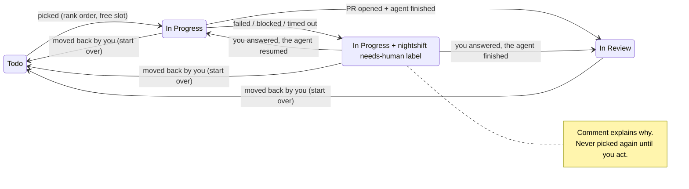
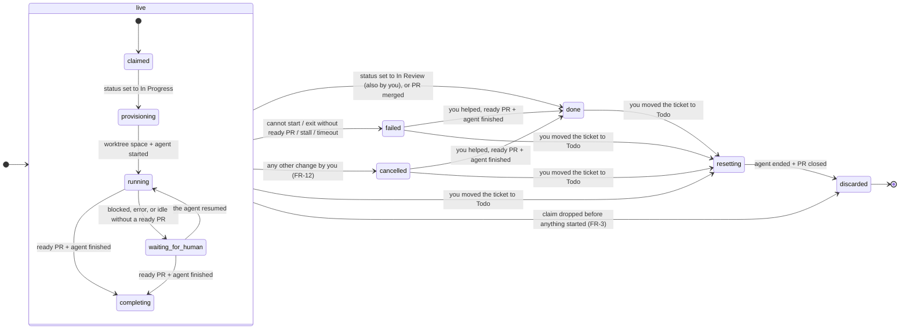

# Nightshift: product spec

Status: draft, 2026-11-21. Covers the core functional and non-functional requirements,
the technical details known so far (section 8), and the plan for building it (section 9).

## 1. Goal

Nightshift is a personal software factory. It watches your GitHub Project boards, takes
the highest-ranked ready ticket, and gives it to a Claude Code agent. The agent works in
its own git worktree of the ticket's repo and opens a pull request. Nightshift then moves the ticket to review.
You watch and step in through Herdr, where every agent runs in its own worktree that
you can see.

**What success looks like:** you label tickets `nightshift`, rank them in the Todo
column, start Nightshift, and walk away. When you come back, each ticket is either In
Review with a PR, or flagged as needing you, with a comment saying why. No ticket is
lost, duplicated or stuck without a signal, even if Nightshift, Herdr or the machine
restarted in between.

### Principles

1. **One flow, not a framework.** Nightshift supports exactly one setup: GitHub
   Project boards with GitHub Issues, Claude Code, Herdr, and git worktrees, on one macOS
   machine. Nothing is pluggable in this version; other issue trackers are planned
   (section 7).
2. **Convention over configuration.** A setting exists only for something that truly
   varies per project or environment, such as which boards to watch or how long a run may
   take. Personal preference is not a reason for a setting: Nightshift picks one good
   behaviour and fixes it in the code. Where a sensible default exists, the setting is
   optional.
3. **One instance, many boards and repos.** One Nightshift instance per machine serves
   every board and repo listed in `~/.nightshift/nightshift.yaml`. Repos are listed as
   paths to your local clones, and worktrees are created from them. Nothing of
   Nightshift's is stored in the repos themselves.
4. **Reuse what the tools already have.** Repo-specific agent behaviour (instructions,
   allowed tools, permissions) lives where Claude Code already reads it: the repo's
   `CLAUDE.md` and `.claude/settings.json`. Nightshift does not duplicate it.
5. **Never surprise the human.** Every board change Nightshift makes is explained on the
   issue. Nightshift follows your manual changes on the board and never fights them.
6. **Simple and reliable beats clever.** Every requirement below is judged by one test:
   does it keep the single flow simple and reliable?
7. **When in doubt, keep it.** It is hard to see what a change in one system (GitHub) does
   to another (local worktrees, tabs, branches). So a change on GitHub never destroys
   local work. Nightshift closes or removes something only when nothing in it can be lost
   and nobody is using it; otherwise it leaves it, says so, and lets you decide. A leftover
   is a smaller problem than lost work.

### Setup

```bash
uv tool install git+https://github.com/lacuna-core/nightshift
nightshift init   # asks for boards, their agent limits and repos; writes ~/.nightshift/nightshift.yaml
nightshift start
```

The repos must already be cloned. To add a board or repo later, run `nightshift init`
again or edit the file, run `nightshift check`, then restart.

## 2. Glossary

| Term | Meaning |
|------|---------|
| **Board** | A GitHub Project (v2) listed in `nightshift.yaml`, whose `Status` field has the options `Todo`, `In Progress` and `In Review`. |
| **Ticket** | A GitHub Issue that is an item on the board. Draft items and PRs are ignored. |
| **Ticket ID** | What identifies a ticket in its repo, used in stored data, logs and names. It is text, made of `[a-z0-9-]`. For GitHub it is the issue number, e.g. `42`; another tracker could use e.g. `proj-42` (section 8.7). |
| **Rank** | The item's position in the board's manual order (drag and drop). Top is highest. |
| **Repo** | A repository Nightshift works on, listed in `nightshift.yaml` by the path of its local clone. Its `origin` remote names it on GitHub (`<owner>/<repo>`), which is its identity. |
| **Run** | One attempt by one agent at one ticket. |
| **Live run** | A run that is `claimed`, `provisioning`, `running`, `waiting_for_human` or `completing`. |
| **Ended run** | A run that is `done`, `failed` or `cancelled`. |
| **Current run** | The ticket's only run that is not `discarded`, live or ended. |
| **The PR** (of a run) | A PR in the run's repo, from the run's own branch in that repo (not a fork), to the default branch. If there are several, the open one counts, else the merged one, else the newest. A PR is only ever "the PR" of one run. |
| **Taken over** | You removed the `nightshift` label from the ticket at any time since the run started, live or ended. The run stays taken over, even if the label comes back. |
| **Slot** | Room for one running agent, limited by its board's `max_parallel_agents`. A run uses a slot of the board it was picked from. |
| **Instance** | One running `nightshift start`. There is one per machine, serving all listed boards and repos. |
| **Herdr** | The [herdr-app](https://github.com/herdrdev/herdr-app) desktop app and its core. The window shows spaces and tabs; the core runs the terminals in them and keeps them alive when the window closes. |
| **Repo space** | The Herdr space on a repo's local clone. Its worktree spaces are grouped under it. |
| **Worktree space** | The Herdr space for one run's worktree, grouped under the repo space. It has one tab, where the agent runs. |

## 3. Ticket lifecycle

Board statuses Nightshift reads and writes. The names are fixed: `Todo`, `In Progress`,
`In Review`. Other statuses on the board (e.g. `Done`) are left to you.



Internal run states (not shown on the board):



`done`, `failed` and `cancelled` runs stay as they are until you move the ticket to Todo,
except that a failed or cancelled run you helped along becomes `done` (FR-18).
A reset that has started always finishes, even if the ticket is moved again meanwhile.

Who does what:

| Step | Who |
|------|-----|
| Add the `nightshift` label, rank tickets | You |
| Move Todo → In Progress → In Review | Nightshift |
| Write the code, push the branch, open the PR | The agent |
| Review and merge the PR | You. Neither Nightshift nor the agent ever merges. |
| Close the issue | GitHub, when the PR is merged (`Closes #<n>`), or you. Neither Nightshift nor the agent closes issues. |
| Move the ticket to `Done` | You, or the board's own GitHub automation |
| Delete a branch on GitHub (after a merge, or of a discarded run) | You, or for merged PRs the repo's GitHub setting |
| Close the worktree space, remove the worktree and local branch | Nightshift, only when it is safe (FR-13); otherwise you |

A ticket moved back to `Todo` is the exception: Nightshift then also closes its PR, and
keeps its branch, locally and on GitHub (FR-16).

## 4. Functional requirements

Each requirement has an ID for the plan to refer to.

### Intake

**FR-1 Watch the boards.** Nightshift polls every board every 60 seconds (see NFR-6) and
finds eligible tickets. A ticket is eligible when all of these hold:
- its `Status` is `Todo`;
- it has the `nightshift` label;
- it is an open Issue (not a draft item or PR) in one of the listed repos;
- it is on only one listed board;
- it does not have the `nightshift:needs-human` label;
- it has no current run (FR-16).

Nightshift never touches a ticket without the `nightshift` label. Adding the label is
the single act that hands a ticket to the factory, so the board can also hold work
meant for you.

Any board can hold issues from any listed repo, and one repo's issues can be spread over
several boards. Two cases get a signal instead of silence:
- A `Todo` ticket with the `nightshift` label from a repo that is not listed is left
  alone and shown by `nightshift status`; `nightshift check` shows its repo in red.
- A `Todo` ticket with the `nightshift` label on more than one listed board has no single
  status or rank. Nightshift labels it `nightshift:needs-human` and comments why; remove
  that label yourself once the ticket is on one board. For a ticket with a current run only
  the board it was picked from counts, whatever its status on another board.
- An `In Progress` ticket with the `nightshift` label but no current run has no agent.
  Nightshift labels it `nightshift:needs-human` and comments why, once. It never adopts an
  existing branch for it.

`nightshift:needs-human` on a ticket with a running agent has no effect if you add it, and
Nightshift does not add it back if you remove it.

**FR-2 Pick by rank.** When a board has a free slot, Nightshift picks its eligible ticket
with the highest rank: the top of the board's manual (drag) order. Ties cannot happen
with manual order. Sorting by a field (Priority, Size, Iteration) is not supported. Boards are independent: each fills its own slots, and none waits for
another.

**FR-3 Claim before work.** Before any agent starts, Nightshift records the claim durably
(NFR-3), re-reads the ticket, and sets its `Status` to `In Progress`. If that fails,
nothing starts: the claim is repeated on the next poll while the ticket is still eligible,
and dropped (`discarded`) when it is not. Running the same claim twice does no harm.

Before each claim Nightshift checks what every run needs: Herdr, the `gh` login, Claude
Code, the repo's clone and a successful fetch. If something is missing, no ticket is
claimed, so a general failure never marks ticket after ticket as failed. Picking goes on
once it is back, `status` shows it, and live runs are left alone.

### Concurrency

**FR-4 Parallel limit.** Each board's `max_parallel_agents` caps the number of its live
runs, whichever repos they are in. A run that is waiting for
you still holds its slot: it keeps its context and you can unblock it. There is no limit across boards: the most agents that
can run at once is the sum of the boards' limits. Lowering a limit never kills running
agents; it only stops new picks on that board until enough of its runs end.

### Running an agent

**FR-5 Branch and worktree.** For each run Nightshift creates a git worktree from the
local clone of the ticket's repo, from the latest default branch on GitHub, on a new branch
named `<ticket-id>/<short-kebab-description>` (e.g. `42/export-csv`):
- `<ticket-id>` is the ticket ID (section 2): for GitHub the issue number, without `#`. It
  ties the branch to its ticket.
- `<short-kebab-description>` comes from the issue title: lowercase, `[a-z0-9-]` only,
  whole branch ≤ 40 characters, including the index below.
- If the title gives nothing usable, the description is `ticket`.
- If that branch already exists, locally or on GitHub, or its worktree directory does, or
  an earlier run of the repo used the name, an index is added: `42/export-csv-2`, then `42/export-csv-3`, and so on, up to the first
  free name. This is the normal case when a ticket starts over (FR-16), and it also keeps
  Nightshift off branches it did not create.

The branch name never changes during the run. Two repos can have
the same branch name, so a ticket is always identified by repo and ticket ID, never by branch
alone.

The clone stays yours to work in: Nightshift fetches, and adds and removes its own
worktrees and branches, but never changes the clone's checked-out branch or files.

**FR-6 Herdr layout.** Every agent session gets its own Herdr space:
- **Repo space.** Each repo has one Herdr space on its local clone, holding a shell.
  `nightshift start` creates the missing ones for all listed repos and reuses those that
  exist, including one you renamed or made yourself. One you close
  while the loop runs is created again when the next run in that repo starts.
- **Worktree space per run.** Each run has one Herdr space on its worktree (FR-5). Herdr
  nests it under the repo space by itself, because both belong to the same git repo.
- **One tab per worktree space.** The worktree space has a single tab, where Claude Code
  runs interactively, inside a shell that stays open after Claude Code exits. You can
  watch it, type into it and take over at any time. You can open more tabs there.
  Nightshift never touches tabs or terminals it did not create, except to close the whole
  worktree space in cleanup (FR-13).
- **Names.** A space gets its name from Herdr, after its folder: the clone's folder for a
  repo space, `<ticket-id>-<short-kebab-description>` for a worktree space. The agent's tab
  is named the same as its worktree; a tab you named yourself is left alone. Tabs are
  named only while the Herdr window is open, and a missing tab name never holds up a run.
- **The window is not required.** Nightshift works with the Herdr window closed, and a new
  space never takes the focus.
- **Terminals outlive the loop.** Stopping Nightshift, or closing the terminal it runs in,
  does not end agents.

How this is done is in section 8.3.

Example: one instance serves two boards, each with `max_parallel_agents: 3`. One has the
tickets of the repo `webapp`, the other those of `api`. Each has three runs holding a
slot and one finished worktree whose PR waits for review. The worktree
`57-fix-login-redirect` is selected. The drawing is schematic, not Herdr's exact look:

```text
┌───────────────────────────────┬──────────────────────────────────────────────────────────────┐
│─ Spaces ──────────────────────│ [57-fix-login-redirect]                                      │
│ webapp                        │──────────────────────────────────────────────────────────────│
│ ├─ 42-export-csv              │ ~/.nightshift/worktrees/acme-webapp/57-fix-login-redirect    │
│ ├─ 57-fix-login-redirect      │                                                              │
│ ├─ 61-dark-mode               │ * Claude Code                                                │
│ └─ 63-search-filters          │                                                              │
│                               │ I traced the redirect after login to two places:             │
│ api                           │   1. middleware/auth.ts sends everyone to /dashboard         │
│ ├─ 12-rate-limit-headers      │   2. pages/login.tsx reads ?next= but never uses it          │
│ ├─ 15-retry-timeout           │                                                              │
│ ├─ 18-openapi-docs            │ The issue doesn't say whether ?next= may point to            │
│ └─ 21-health-endpoint         │ another domain. Should I allow only same-origin              │
│                               │ URLs and fall back to /dashboard otherwise?                  │
├─ Agents ──────────────────────┤ >                                                            │
│ * 42-export-csv               │                                                              │
│ ! 57-fix-login-redirect       │                                                              │
│ * 61-dark-mode                │                                                              │
│ + 63-search-filters           │                                                              │
│ * 12-rate-limit-headers       │                                                              │
│ * 15-retry-timeout            │                                                              │
│ * 18-openapi-docs             │                                                              │
│ - 21-health-endpoint          │                                                              │
└───────────────────────────────┴──────────────────────────────────────────────────────────────┘
```

Agent states: `*` working, `!` blocked, `+` done (not looked at yet), `-` idle (seen).

Reading the example:
- **Slots.** The blocked agent still holds its slot (FR-4), so both boards are full and
  Nightshift waits. A finished worktree (`done` or `idle`, PR open) holds no slot (FR-9).
- **Finished worktrees** stay until you merge the PR, and longer if removing one is not
  safe (FR-13).
  `done` means you have not looked at it yet; `idle` means you have.

**FR-7 Agent brief.** Claude Code starts with a fixed prompt built into Nightshift. It
contains the ticket ID, title, body, labels, branch name and repository, and
the comments of people with write access to the repo (without Nightshift's own),
and tells the agent to:
- implement the issue following the repo's own `CLAUDE.md`, on the branch it was given
  (never create or rename a branch, even if the repo's branch-naming rule says
  otherwise);
- commit with Conventional Commits, push the branch, and open a PR (not a draft) that
  says `Closes #<n>`;
- **stop at the PR**: never merge, never close the issue, never move the board item
  (Nightshift does that).

Anything project-specific belongs in the repo's `CLAUDE.md`, not in Nightshift. The
prompt overrides any ship-and-merge skill in the repo (such as this repo's `/done`).

**FR-8 Unattended permissions.** Agents run without anyone answering permission prompts.
Nightshift starts Claude Code in `acceptEdits` mode; anything else the agent may do is
the repo's own allowlist in `.claude/settings.json`. It never uses
`--dangerously-skip-permissions`, which would need a sandbox. A prompt the agent cannot
get past moves the run to `waiting_for_human` (FR-10).

### Completion and hand-off

**FR-9 Detect completion.** A run is complete when both hold:
1. its PR (glossary) is open and not a draft, called a **ready PR**, and
2. the agent has finished its turn: its Herdr agent state is `idle` or `done` on two polls
   in a row, and it was not stopped by a usage limit (FR-17); or Claude Code has exited.

Then Nightshift sets the ticket's `Status` to `In Review`, comments a link to the PR on
the issue, and frees the slot. The worktree space stays so you can follow up (FR-13).
The same rules hold in the loop and after a restart.

**FR-10 Detect "needs you".** A run moves to `waiting_for_human` when its agent:
- is `blocked`: it asks a question or waits on a permission;
- reports an `error` other than a usage limit (FR-17);
- is `idle` or `done` for 5 minutes without a ready PR. It may have asked in plain text;
- or has reported no state 2 minutes after it started: Claude Code is showing a dialog from
  before its session, such as the one that asks to trust a folder, or its shell asks something
  before it runs Claude Code.

Nightshift then adds the `nightshift:needs-human` label and comments why. When you answer in the tab and the agent resumes, the run returns to
`running` and the label is removed.

**FR-11 Failure, stall and timeout.** A run fails when:
- Claude Code exits without a ready PR (see NFR-4 for the causes that are not this);
- the agent is `working` but shows no activity for longer than `stall_timeout` (default 20
  minutes). Activity is any change of its state, turn or screen;
- it has been running for longer than `max_run_time` (default 3 hours);
- or its branch, worktree or worktree space cannot be created.

Both clocks run only while the run is `running` and Nightshift is watching it: not while it
waits for you, waits for a usage limit, or Nightshift is stopped, the machine sleeps or
Herdr is unreachable.

On failure, Nightshift interrupts the agent if it is still working (FR-12), keeps the
worktree space, labels the ticket `nightshift:needs-human`, comments the reason, and
frees the slot. There is no automatic retry: an agent that
failed once on a ticket usually fails again and costs usage. To retry, move the ticket back
to `Todo`: it starts over (FR-16).

**FR-18 Runs you helped along.** A `failed` or `cancelled` run whose ticket is still
`In Progress` becomes `done`, and its ticket moves to `In Review` as in FR-9, once the rules
of FR-9 hold and something happened after the run ended: the agent had a new turn, or the PR
was opened or reopened. `nightshift:needs-human` is removed. The run takes no slot and has
no timeouts meanwhile. A run you took over is left alone.

**FR-19 Notifications.** Nightshift sends a macOS notification when a run needs you (FR-10)
or fails (FR-11), when a ticket moves to `In Review` (FR-9), and once when a usage limit
starts (FR-17).

**FR-17 Usage limits.** When Claude Code hits a subscription limit, Nightshift stops picking
new tickets on all boards until the limit resets, then carries on by itself. `status` says
so, and until when if that is known. For agents the limit stopped:
- The run stays `running` and keeps its slot. It is not a failure and does not need you, so
  it gets no `nightshift:needs-human` label (FR-10).
- Time spent waiting does not count towards `stall_timeout` or `max_run_time`.
- When the limit resets, Nightshift sends the agent "continue" in its existing session. It
  does so only if the run is still live and the agent is still stopped by the limit, so an
  agent you already continued yourself gets nothing.
- If the agent hits the limit again, it waits again.
- If it is not known when the limit resets, Nightshift tries again every 30 minutes, with one
  agent or, if none is waiting, one new ticket.
- "Still stopped by the limit" means the agent has had no new turn since.

### Reconciliation with what you do

**FR-12 Respect manual changes.** On every poll Nightshift compares its runs with the
board and acts on what you changed. **It leaves the ticket's board status and the issue's
open or closed state as you set them**: in response to your change it never moves the
ticket, and never closes or reopens the issue. All it may change on the ticket is the
`nightshift:needs-human` label, plus a comment (FR-15).

| You did this | Agent and run | Tab and worktree space | Worktree and branch | Board status | Issue | `needs-human` label |
|--------------|---------------|------------------------|---------------------|--------------|-------|---------------------|
| Moved a ticket that has a run back to Todo, from any status, with the `nightshift` label on | Ended; starts over (FR-16) | Closed only if the worktree is removed, else left open | Worktree removed only if it is safe, else kept; branch kept, locally and on GitHub; an open PR is closed | Left in Todo until it is picked again | Left open | Removed |
| Removed the `nightshift` label from a ticket that has a run (you take it over) | If the run is live: interrupted; run `cancelled` | Left open, never touched again | Kept, never touched again | Left as is | Left open | Left as is |
| Merged the PR | Left to finish its turn; the run stays live until then, then `done` | Closed by cleanup (FR-13) | Worktree and local branch removed by cleanup | Left as is | Left as is: GitHub closes it (`Closes #<n>`) | Left as is |
| Closed the issue, with no merged PR | Interrupted; run `cancelled` | Left open until you close it | Worktree kept until you close the agent's tab, then removed by cleanup (FR-13); branch kept | Left as is | Left closed | Left as is |
| Closed the PR without merging | Interrupted; run `cancelled` | Left open | Kept | Left as is | Left open | Added if the run was live |
| Moved the ticket to Done | Interrupted; run `cancelled` | Left open | Kept | Left in Done | Left as is | Left as is |
| Moved a ticket with a live run to `In Review`, with a ready PR | Left to finish its turn; the run stays live until then, then `done` | Left open | Kept | Left in In Review | Left open | Left as is |
| Moved a ticket with a live run to any other status (e.g. `Backlog`, or `In Review` without a ready PR) | Interrupted; run `cancelled` | Left open | Kept | Left as is | Left open | Left as is |
| Removed a ticket with a live run from the board | Interrupted; run `cancelled` | Left open | Kept | None | Left open | Left as is |
| Closed the agent's tab or its worktree space during a live run, with no ready PR (with one, the run is complete: FR-9) | Ended by you; run `cancelled` | Left closed; other tabs you left open stay | Kept | Left in In Progress | Left open | Added |
| Closed the agent's tab or its worktree space after the run ended | Nothing to do | Left closed; other tabs you left open stay | Kept | Left as is | Left as is | Left as is |

How to read the table:
- **Interrupted** means the current turn is stopped, as if you pressed Esc. Claude Code
  stays open in its tab with its conversation, so you can carry on from there. A run that
  has already ended keeps its state and is not interrupted: whatever its agent does is
  your follow-up. Nightshift repeats the interrupt until it sees the agent stopped, but
  never after a new turn you started. If it cannot be stopped, the ticket gets
  `nightshift:needs-human` and a comment.
- **Closed the PR** counts only once the agent's turn has ended, because an agent may close
  its own PR to open another. Changes Nightshift makes itself are never taken as yours.
- **Any `nightshift:needs-human` label** Nightshift adds comes with one comment saying why.
- **Ended** means Claude Code is exited. The shell in its tab stays (FR-6), and so does
  the conversation, which you can resume there.
- **Left open** and **kept** last until a cleanup rule applies later (FR-13), for example
  when the PR is merged.
- **Tab and space** go together: the worktree space closes with its last tab, so it stays
  if you opened other tabs in it. Only cleanup closes the space with all its tabs.
- **Safe** and **by cleanup** mean by the rules of FR-13.
- **Removed from the board** means GitHub confirms the item is gone or archived. Something
  Nightshift cannot read or reach is never taken as removed, closed or merged (NFR-11).

Nightshift itself is not the only one that moves tickets: the board's own GitHub
automation may set `Done` when an issue is closed or a PR is merged, or close an issue
moved to `Done`. Nightshift treats such a change as yours.

Nightshift re-reads a ticket right before it changes it, and reads the boards before the
PRs and issues, so that it does not overwrite or misread what you just did. If you remove
a worktree by hand, its run counts as cleaned up.

If several of these are true on one poll, the first that applies wins: `nightshift` label
removed, PR merged, issue closed, moved back to Todo, then the rest in table order. A merged PR counts
only until its run has ended, so reopening the issue and moving the ticket back to Todo
starts over as usual.

**FR-16 Start over.** Moving a ticket back to `Todo`, with the `nightshift` label on, means
"start from scratch". It applies to any ticket with an earlier run, whether the run is
live, failed, cancelled or finished, as long as the issue is open. Nightshift:
1. ends the agent of a live run, and frees its slot;
2. closes the open PRs of the ticket's earlier runs;
3. keeps the branch, locally and on GitHub, with every commit on it;
4. removes the `nightshift:needs-human` label;
5. marks the run `discarded`;
6. closes the agent's tab and removes the worktree, if that is safe (FR-13);
7. comments on the issue what it closed and what it kept, with the PR, the branch and the
   path of a kept worktree.

The ticket is then an ordinary `Todo` ticket: when a slot is free and its rank comes up,
it gets a new branch with the next index (FR-5), from the latest default branch, and a new
worktree, worktree space and Claude Code session. More rules:
- **The new run does not wait for the old worktree.** It has its own branch and folder, so
  an old worktree that is not safe to remove simply stays. Nightshift checks it on every
  poll and removes it once it is safe.
- The ticket is not picked until steps 1 to 5 have succeeded. A failed step is retried on
  the next poll and shown by `status`. Every step is safe to repeat.
- **A run you took over (FR-13) is left alone entirely**, its PR and agent included.
  Nightshift only starts the new run next to it, and says so on the issue.
- An agent whose run had already ended is not ended if it is `working` or `blocked`:
  Nightshift had stopped it, so you started it again and may be using it.
- Nightshift closes only PRs from branches the ticket's runs created.
- A ticket counts as moved back only if Nightshift has seen it out of `Todo` since it was
  claimed, or sees it in `Todo` on three polls in a row, so a stale answer from GitHub
  cannot discard a run.

**FR-13 Cleanup.** Nightshift closes the worktree space, with every tab in it, including
ones you opened there (for debugging, a dev server), and whatever runs in them. Then it
removes the worktree. It does so only for a reason, and only when it is safe.

The reason is one of these:
- the PR is merged;
- the issue is closed and you closed the agent's tab yourself. A closed issue alone is not
  enough: it may be a mistake, or the board's automation;
- the run was discarded (FR-16).

It is safe when all of these hold:
- the worktree has no uncommitted or untracked files. For a discarded run, files git ignores
  count too, so it is often kept (a `.venv` is enough); otherwise they are removed with it;
- the worktree is on the run's branch, with no rebase, merge, cherry-pick or bisect in
  progress, so no commit exists only there;
- no agent in the worktree, Nightshift's or yours, is `working` or `blocked`;
- for a discarded run only: no terminal other than the agent's is open in the worktree, and
  the agent's own shows Claude Code or an empty shell prompt. Otherwise your own tabs do
  not block cleanup;
- the branch stays, or everything on it is merged (below);
- you did not take the run over.

All of this is checked before anything is closed, including what would make git refuse (for
example submodules), and again right before the worktree is removed. Otherwise nothing is
closed or removed. Nightshift comments once on the issue what it kept
and why, lists it in `nightshift status`, and checks again on every poll. More rules:
- **The local branch is deleted only after a merge**, and only if everything on it is in
  the merged PR (section 8.4). If it has other commits, it and its worktree are kept.
- **Ended runs are watched until cleaned up.** A run ends long before its PR is merged, so
  Nightshift keeps checking every ended run on each poll until its cleanup is done. After
  a restart it catches up on merges and closed issues it missed.
- **Runs you took over are not watched.** Nightshift comments once, when you take the run
  over, and acts on the ticket again only if it starts over (FR-16).

### Operating it

**FR-14 CLI.** Five commands, run from any directory. They all act on
`~/.nightshift/nightshift.yaml`.

- `nightshift init`: set up Nightshift on this machine, interactively.
  - Asks for the boards: lists your GitHub Projects (`gh`) to choose one or more from, or
    takes URLs. For each board it asks for `max_parallel_agents`, with a default of 5.
  - Asks for the repos: paths to one or more local clones.
  - Runs the same checks as `nightshift check`.
  - Creates the two labels in each repo if they are missing.
  - Writes `~/.nightshift/nightshift.yaml`, also if a check failed, so that you can fix it
    and run `check`.

  Running it again shows the current values as defaults and rewrites the file, after
  confirmation (`--yes` skips it). Optional settings already in the file are kept.
- `nightshift check`: validate the setup and report each problem with how to fix it. It
  is read-only, works whether or not the loop is running, and exits with an error if
  a check fails. It covers:
  - **Config:** the file is valid, and no board or repo is listed twice.
  - **Tools:** GitHub access (with the `project` scope), Herdr (found, supported version, core running), and
    Claude Code.
  - **Repos:** each path is a git clone with a GitHub `origin` you can push to. Missing
    labels are reported but are not a failure: `init` and `start` create them. A
    `.claude/settings.json` that does not allow `git commit`, `git push` and `gh pr create`
    is a warning: every agent would stop and wait for you. So is a clone that Claude Code
    does not trust yet: run `claude` in it once and accept (its worktrees follow the clone).
  - **Board statuses:** the statuses each board has, and which of the required `Todo`,
    `In Progress` and `In Review` are missing. A missing one is a failure: the board is
    skipped until it is fixed.
  - **Board issues:** for each board, its open issues counted per repo, and how many of
    them have the `nightshift` label. A repo listed in `nightshift.yaml` is green, one
    that is not is red. The words `listed` and `not listed` say the same without colour.
    A repo that is not listed is not a failure, since a board can also hold other work.

  ```text
  Board https://github.com/users/<you>/projects/1
    Statuses   Todo, In Progress, Done
               missing: In Review
    Issues     acme/webapp   12 open, 4 nightshift   listed        (green)
               acme/api       7 open, 2 nightshift   listed        (green)
               acme/docs      3 open, 1 nightshift   not listed    (red)
  ```
- `nightshift start`: start the long-running loop, in the foreground, in any terminal,
  inside or outside Herdr. It does not start at login. It runs
  the same checks as `check` first. It refuses to start only for what concerns everything:
  an invalid config, or Herdr, Claude Code or the `gh` login missing. A board or repo with a
  problem is skipped and reported (NFR-11), and GitHub being down is waited out (NFR-6). If a
  board or repo with a live run is no longer listed, it names those runs and asks to cancel
  them (`--yes` skips the question), so that no agent is left running without an owner. It
  interrupts their agents and keeps their tabs, worktrees and branches; without a yes it
  does not start. Then it creates missing labels
  and repo spaces (FR-6).
- `nightshift stop`: stop the loop from any terminal. The loop finishes the step
  it is in (a claim, a worktree creation, a status update), then exits; it never stops
  halfway through one. Agents keep running in Herdr and are picked up again by the next
  `nightshift start` (NFR-4). Ctrl-C in the loop's own terminal does the same. Stopping
  agents is never automatic: remove the `nightshift` label or close their worktree spaces
  (FR-12).
- `nightshift status`: whether the loop is running, its runs grouped by repo, free slots
  per board, boards or repos it cannot reach (NFR-11), worktrees it kept and why (FR-13), ended runs
  it does not watch because their board or repo is no longer listed, a usage limit it waits
  for (FR-17), and what is waiting for you.

**FR-15 Audit trail.** Every board change Nightshift makes is also explained on the issue
(a short comment: picked, PR opened, failed and why). From the issue alone you can see
what happened. A comment is posted once, even if Nightshift crashes in between.

## 5. Non-functional requirements

**NFR-1 Minimal config.** All settings live in `~/.nightshift/nightshift.yaml`, one file
per machine, written by `nightshift init`:

```yaml
boards:
  - url: https://github.com/users/<you>/projects/<n>
  - url: https://github.com/orgs/<org>/projects/<n>
    max_parallel_agents: 2    # optional, default 5

repos:
  - path: ~/dev/webapp
  - path: ~/dev/api
    stall_timeout: 40m        # optional, default 20m
    max_run_time: 5h          # optional, default 3h
```

The timeouts are set per repo, because the right values depend on it: a slow build or
test suite can keep a healthy agent quiet for longer than the default. They are added by
hand when the default does not fit.

Everything else is a fixed convention, listed in NFR-2. More rules:
- The file is specific to this machine and is not meant to be committed. It holds no
  secrets: Nightshift and its agents use your `gh` login.
- Boards and repos are two independent lists. The issue says which repo a ticket belongs
  to, so there is no mapping between them to maintain.
- The file is validated by `init`, `check` and `start`, with errors that name the bad key.
  Unknown keys are errors, not silently ignored.
- Changes take effect when Nightshift restarts. There is no live reload. If a clone was
  moved, change its `path`; `start` repairs the links to its worktrees.

**NFR-2 Fixed conventions.** Built into the code, not configurable:

| What | Convention |
|------|------------|
| Board statuses | `Todo`, `In Progress`, `In Review` |
| Labels | `nightshift` (pick up), `nightshift:needs-human` (stop and look) |
| Branch | `<ticket-id>/<short-kebab-description>`, then with `-2`, `-3`, … if taken, ≤ 40 characters (FR-5) |
| Config | `~/.nightshift/nightshift.yaml` |
| Herdr space names | Herdr's own: the name of the space's folder |
| Herdr tab of the agent | same name as the worktree directory |
| Worktree | `~/.nightshift/worktrees/<owner>-<repo>/<ticket-id>-<short-kebab-description>`, with the same index as the branch |
| Logs | `~/.nightshift/logs/nightshift.log` |
| Poll interval | 60 seconds |
| Retries | none |
| Idle without a ready PR before it needs you | 5 minutes |
| Retry of an unknown usage limit | 30 minutes |
| Claude Code permission mode | `acceptEdits`, plus the repo's own allowlist |

Branch, worktree directory and worktree space come from the ticket ID, one
slug and the same index, so they always match.

The whole folder is in section 8.2.

**NFR-3 Durable state.** Nightshift keeps its state in a local database, so that a crash or
restart loses nothing. Runs are kept after they end, because starting over needs to know
about earlier ones (FR-16). The database itself enforces that a ticket has at most one run
that is not `discarded`. The schema is in section 8.1.

**NFR-4 Crash recovery.** After any crash or restart of Nightshift, Herdr or the machine,
Nightshift reconciles before it picks anything new. It does so in `nightshift start`, and in
the loop whenever Herdr comes back.
- **GitHub, git and Herdr are the truth; the database is the ledger.** For each live run it
  checks the board status, whether the branch and PR exist, whether the worktree exists,
  and whether the agent is alive (section 8.3). An ended run is cleaned up if it now has a
  reason and is safe (FR-13).
- **Why an agent is gone decides what happens**, the same in the loop and after a restart:

| What Nightshift finds | What it does |
|-----------------------|--------------|
| The agent is alive | Re-attached and left alone |
| Herdr cannot be reached | Unknown: nothing, until it is back |
| There is a ready PR (and the agent is gone) | Completed (FR-9) |
| The terminal is there, with a fresh shell after a reboot or Herdr crash | Resumed once, in its worktree space with the same Claude Code session. If it was already resumed once, it fails (FR-11). A crash is not the agent's fault, so this is not a retry |
| The terminal is gone: you closed the tab or space, also while Nightshift was stopped | Cancelled (FR-12) |
| Claude Code exited, its shell is still there | Failed (FR-11) |

- An agent counts as gone only if it is gone on two polls in a row, and never while it is
  still starting.
- **A run is never resumed while any Claude Code runs in its worktree.** It then goes to
  `waiting_for_human`, because you may have resumed it yourself.
- **What a run continues with depends on its state.** `claimed` and `provisioning` repeat
  their steps. `running` is resumed and told to continue. `waiting_for_human`, or stopped by
  a usage limit, is resumed without a message and keeps waiting. `completing` and
  `resetting` repeat their steps; a status Nightshift was about to set is not taken as your
  change.

Invariant: **a ticket never has two live runs**, whatever crashed and when. Every step
(claim, create worktree space, start agent, interrupt, move to In Review, start over,
cleanup) is safe to repeat.

**NFR-5 Single instance.** Only one `nightshift start` per machine and user at a time. A
second one exits with a clear message. A crashed loop never blocks the next start.

**NFR-6 GitHub API budget.** Polling stays well under GitHub's limit of 5,000 points per
hour. On rate limiting or GitHub outages Nightshift backs off and leaves running agents
alone. Webhooks are not used: a laptop has no public endpoint, and a 60-second delay does
not matter here.

**NFR-7 Observability.** Structured logs with `repo`, `ticket_id`, `run_id` and
`branch` on every line about a run, to stdout and to `~/.nightshift/logs/nightshift.log`.
- There is one log file for all boards and repos; the fields are there to filter by.
- It is rotated (section 8.2).
- Agent output is not in it. It stays in the agent's Herdr terminal and in Claude Code's
  own session history.

`nightshift status` covers the rest. A dashboard comes later (section 7).

**NFR-8 Safety.**
- Nightshift never force-pushes, never merges, and never touches a worktree, tab or
  terminal it did not create. The one exception: cleanup closes a worktree space with all
  its tabs (FR-13).
- A change on GitHub never destroys local work. Nightshift never removes uncommitted
  changes, never deletes a branch on GitHub, and deletes a local branch only when all its
  commits are in a merged PR. It closes a tab or removes a worktree only under FR-13.
- It closes a PR in one case only: you moved the ticket back to `Todo` (FR-16). A closed
  PR can be reopened, because its branch is kept.
- `stop` and Ctrl-C are always safe, and so is a hard kill (crash recovery
  covers it, NFR-4). Stopping Nightshift does not kill agents; they keep running in Herdr
  and are re-attached on restart.
- Nightshift never posts terminal or agent output to GitHub, and the prompt contains no
  comments from people without write access to the repo. The issue's title and body are
  included as they are: adding the `nightshift` label means you accept them.
- Agents share your `gh` login. This is a deliberate trade-off for simplicity: an agent
  can do anything on GitHub that you can. The FR-7 prompt and the repo's allowlist are
  the guardrails.

**NFR-9 Simplicity.** A small CLI in this repo. No server, queue or web UI in this version,
and no plugin system or extension points. A new need is met by changing the
code; a setting is added only when the value truly varies per project or environment.

**NFR-10 Testability.** The orchestration logic and recovery rules are unit-tested with
fakes, without GitHub, Herdr, git or Claude Code (section 8.7).

**NFR-11 Isolation.** A problem with one board or repo, at start or while the loop is
running (a deleted board, a missing status, a missing clone, a failed fetch) never stops work on the others.
Nightshift skips it, logs it, shows it in `status`, and tries again on the next poll. A
fetch that fails before a claim leaves the ticket in `Todo`.

## 6. Constraints

1. Coding agent: Claude Code (the `claude` CLI), run interactively in Herdr.
2. Tickets: GitHub Issues on a GitHub Project (v2) board.
3. Terminals: Herdr (herdr-app with herdr-core), tested against a pinned version, because
   its API is a preview (0.x); core 0.1.18 was the one looked at for this spec. The older
   `herdr` terminal multiplexer is a different program and is not supported.
4. Platform: macOS, one machine, the user's own Claude subscription or API key.
5. Python 3, packaged with uv, following this repo's conventions.

## 7. Out of scope

### Planned for later

Not part of this version, but these features will be implemented later. Decisions and
design made now must not block them.

- **Nightshift dashboard.** Shows the current state across all boards and their tickets,
  with ticket statuses, and lets you quickly navigate to the matching Herdr tab, GitHub
  issue or GitHub Project. Exact requirements are TBD.
- **Other issue trackers.** Tickets from other systems, e.g. Jira. Exact requirements are
  TBD.
- **Follow-up after In Review.** Acts on PR review comments and CI failures. Exact
  requirements are TBD.

### Not covered

1. Other agents or harnesses (Codex, OpenCode, etc.).
2. Dependencies between tickets. Ordering is your job, through rank.
3. Merging PRs.
4. Running on several machines or in the cloud.
5. Customizing names, statuses, labels, paths or the agent prompt.
6. Several instances on one machine.
7. Cloning repos. Nightshift works only from clones you already have.

## 8. Architecture

### 8.1 State database

`~/.nightshift/nightshift.db` (SQLite) has one table for runs, and a small one for what
`status`, another process, must be able to show:

```sql
CREATE TABLE runs (
  id                TEXT PRIMARY KEY,  -- run_id, also in logs and the Herdr label
  repo              TEXT NOT NULL,     -- owner/repo
  ticket_id         TEXT NOT NULL,
  repo_ref          TEXT NOT NULL,     -- the tracker's own ID, survives a rename
  ticket_ref        TEXT NOT NULL,     -- likewise (GitHub: node IDs)
  clone_path        TEXT NOT NULL,
  board_url         TEXT NOT NULL,
  board_item_id     TEXT,              -- looked up again by ticket if it is gone
  state             TEXT NOT NULL CHECK (state IN (
                      'claimed', 'provisioning', 'running', 'waiting_for_human',
                      'completing', 'done', 'failed', 'cancelled', 'resetting',
                      'discarded')),
  state_reason      TEXT,              -- why it failed or was cancelled

  branch            TEXT,              -- recorded before it is created (FR-5)
  worktree_path     TEXT,
  herdr_space_id    TEXT,
  herdr_tab_id      TEXT,
  herdr_terminal    TEXT,              -- address; the label decides (8.3)
  claude_session_id TEXT,

  seen_out_of_todo  INTEGER NOT NULL DEFAULT 0,  -- seen outside Todo since claim (FR-16)
  taken_over        INTEGER NOT NULL DEFAULT 0,  -- label was removed (FR-13)
  resume_count      INTEGER NOT NULL DEFAULT 0,  -- at most 1 (NFR-4)
  limited_since     TEXT,              -- stopped by a usage limit since (FR-17)
  active_seconds    INTEGER NOT NULL DEFAULT 0,  -- counts towards max_run_time (FR-11)
  turn_at_end       INTEGER,           -- agent's turn when the run ended (FR-18)
  stop_requested_at TEXT,              -- interrupt sent, not yet confirmed (FR-12)
  pr_ref            TEXT,              -- the PR, once seen
  tab_named         INTEGER NOT NULL DEFAULT 0,  -- FR-6
  kept_reason       TEXT,              -- why cleanup waits, so it comments once (FR-13)

  created_at        TEXT NOT NULL,
  started_at        TEXT,
  last_activity_at  TEXT,              -- for stall_timeout
  ended_at          TEXT,
  cleaned_up_at     TEXT
) STRICT;

-- A ticket has at most one run that is not discarded (FR-1, NFR-4).
CREATE UNIQUE INDEX one_current_run ON runs (repo, ticket_id)
  WHERE state <> 'discarded';

-- A branch belongs to one run (FR-5).
CREATE UNIQUE INDEX one_run_per_branch ON runs (repo, branch)
  WHERE branch IS NOT NULL;

-- What the loop knows beyond runs: a usage limit and its reset time, boards and repos it
-- cannot reach, steps that failed (FR-14, FR-16, FR-17).
CREATE TABLE loop_state (
  key        TEXT PRIMARY KEY,
  value      TEXT NOT NULL,            -- JSON
  updated_at TEXT NOT NULL
) STRICT;
```

- **Nothing else is stored.** Boards and repos are in the config and tickets are on GitHub;
  copies would go stale. History is in the issue comments (FR-15) and the log (NFR-7).
- **Rows are never deleted.** Starting over marks a run `discarded`; its leftover worktree
  is still watched until `cleaned_up_at` is set (FR-13).
- **Timestamps** are UTC, ISO 8601.
- **The schema version** is SQLite's `user_version`, so a later version can migrate the
  file.

### 8.2 Files

```text
~/.nightshift/
├─ nightshift.yaml        config
├─ nightshift.db          state (SQLite)
├─ nightshift.lock        single-instance lock
├─ logs/
│  └─ nightshift.log      current log; rotated files stay next to it
└─ worktrees/
   └─ <owner>-<repo>/<ticket-id>-<short-kebab-description>/
```

- **Log rotation:** at 10 MB; rotated files are kept for 14 days. Logs are written with
  loguru.
- **Lock:** it holds the process of the running loop, which is how `stop` and `status` find
  it. A lock left by a crashed loop is detected and replaced.

### 8.3 Herdr

Nightshift uses the core's CLI, `hc`, for everything except naming tabs.

- **Starting terminals.** `hc run --bg --keep --no-parent`. Without `--no-parent`, a
  terminal started from a Herdr terminal ends with it.
- **Placing them.** The labels `herdr.space=<id>` and `herdr.tab=<id>` put a terminal in a
  space and tab; an id Herdr does not know creates them. Nightshift makes up the ids. A
  space made this way is named after its folder, and Herdr nests a worktree's space under
  its repo's because both share one git folder.
- **Finding them.** Each agent terminal also has a label with its ticket and run.
- **Finding a repo space.** A repo has one if a live terminal that belongs to a space was
  started in the clone's folder.
- **The agent's shell.** The terminal runs an interactive shell that runs `claude` and stays
  open after it exits.
  A shell can ask something before that: Oh My Zsh did, whether to update. Its check is turned
  off for this shell; any other question is FR-10. A lost terminal's fresh shell can ask too and
  take the resuming command as its answer, so that command is typed a second time if Claude Code
  did not start.
- **Naming the tab.** `herdr-app do tab.rename`, once per run, if the tab still has Herdr's
  default name (`1`). It needs the window open; otherwise it is tried on later polls.
- **Agent state.** `idle`, `working`, `done`, `blocked` or `error`, read with `hc`. Claude
  Code reports it to Herdr itself (OSC 7501), so no hooks are needed.
- **Is the agent alive?** Yes, if a live terminal has the run's label and Claude Code is its
  foreground program. The label decides, not the stored address. After a reboot or core
  crash Herdr keeps a terminal's address but puts a fresh shell in it, so a live terminal
  alone does not mean a live agent.
- **Reading its state** counts only while Claude Code is the foreground program, because a
  terminal can still show the last state after it exited.
  Until it has a session Claude Code reports nothing (state `null`), the trust dialog
  included. A plain-text question is reported as `done`, a tool's question or a permission
  prompt as `blocked`, with a `kind` and a message. `turn` goes up each time the state leaves
  `working`, also to `blocked`.
- **Why a terminal is gone** comes from the reason Herdr records for it (NFR-4): `killed` when
  it was closed, `exited` when its shell ended. A lost one is not gone at all: it is live, with
  its address and labels, but a plain shell as its `argv` and a new `pid`. A Claude Code that
  exited leaves both as they were, also when it was killed. Nightshift records the `pid` as a
  label, to tell the second loss from the first.
- **Interrupting** an agent (FR-12) is `hc interrupt`, which stops the turn, not the process.
  It does not always succeed, so the result is checked. It also ends a dialog the agent is
  `blocked` on.
- **Ending** an agent (FR-16) is interrupting it and then pressing ctrl+c twice. Sending
  `/exit` is not safe: text already in the input box turns it into a message to the agent.
- **Sending** is refused while the agent is `blocked`, so "continue" never answers a dialog.
- **`hc` starts the core** if it is not running, so "core running" is only ever a question of
  whether `hc` works.
- **Closing a worktree space** (FR-13) is `hc kill` on every terminal in it.

### 8.4 Git

- **Creating a worktree.** Fetch, then `git worktree add` from the clone, with the default
  branch as GitHub reports it. The branch name is chosen and recorded before anything is
  created, so repeating the step after a crash uses the same name.
- **No upstream.** The branch is created with `--no-track`, so that a bare `git push` cannot
  target the default branch.
- **Removing a worktree.** `git worktree remove`, never with `--force`. Git refuses to remove
  uncommitted or untracked files, but not a detached HEAD with commits of its own, which is
  why FR-13 checks the branch.
- **A moved clone** is followed by `git worktree repair`.
- **Is a branch merged?** Yes, if GitHub says the PR is merged and the branch's last commit
  is in that PR. Git alone cannot tell, because a squash merge leaves the branch looking
  unmerged.

### 8.5 GitHub

- **Login.** The token comes from `gh auth token`.
- **Names and IDs.** `<owner>/<repo>` is taken as GitHub writes it. Repos and tickets are
  matched by GitHub's own IDs, so a rename changes nothing. A transferred issue ends its run
  (`cancelled`).
- **Taken over** (glossary) is read from the issue's label events since the run started, so
  a label removed and put back between polls, or while Nightshift was stopped, is seen.
- **Comments** carry a hidden marker with the run and event, so that none is posted twice and
  Nightshift's own are recognized (FR-7, FR-15).
- **Polling.** GraphQL: per poll, one query per board for its candidate items, and one for
  the issues and PRs of runs not cleaned up yet.

### 8.6 Claude Code

- **Starting.** `claude` in the worktree, with `--permission-mode acceptEdits` (FR-8), a
  session ID made up by Nightshift (`--session-id`), and the prompt (FR-7). The prompt is
  untrusted text: it is passed so that no shell interprets it.
- **Resuming after a crash.** `claude --resume <session-id>` (NFR-4).
- **Detecting a usage limit** (FR-17). Claude Code writes it to the session's transcript
  (`~/.claude/projects/*/<session-id>.jsonl`): the last message is an API error with
  `apiError: usage_limit_reached` and `quotaLimits.resetsAt`, in seconds since 1970. The limit
  is over for an agent when a later message follows. The format is not documented, so anything
  unexpected counts as no limit, and the agent needs you instead (FR-10).
- **Continuing after a limit** (FR-17). `hc send <terminal> "continue"`.

### 8.7 Code boundaries

- A Python CLI. GitHub, Herdr, git and Claude Code are each behind one small interface,
  which tests replace with fakes. GitHub calls use an injected `httpx` transport (per
  `CLAUDE.md`).
- **Ticket ID.** Nothing outside the GitHub boundary may assume that a ticket ID is a number
  or has anything to do with GitHub. The `Closes #<n>` line in the prompt (FR-7) comes from
  that boundary too.

### 8.8 Verified

Tried with Herdr core 0.1.18 (an isolated core, `HC_SESSION`) and Claude Code
2.1.323. What was found is in sections 8.3 and 8.6.

| Assumption | Result |
|------------|--------|
| `hc interrupt`, `hc send` and ending work on Claude Code | Yes, but ending needs ctrl+c, not `/exit` (8.3) |
| State for a plain-text question, a question tool, a permission prompt | `done`; `blocked` (`question`); `blocked` (`permission`) |
| State for the trust dialog of a worktree | None at all, so it needs its own rule (FR-10). A worktree of a trusted clone shows no dialog |
| A usage limit and its reset time can be detected | Yes, from the transcript (8.6): seen in four real ones. Continuing after one is not tried yet |
| A closed terminal can be told from a lost one | Yes (8.3) |
| A lost agent can be resumed in its own terminal | Yes, with the same session |
| The prompt reaches Claude Code without a shell interpreting it | Yes, as an argument, up to 200 KB tried |
| A space made through labels keeps its IDs, is named after its folder, and takes no focus | Yes, with the window open |
| A tab can be named with `herdr-app do tab.rename` | Yes |
| `hc kill` on a space's terminals closes it, and its worktree can then be removed | Yes |
| `lsof` finds the folder of every Claude Code process, with the pid Herdr shows | Yes |
| A ticket's whole life with a real agent: PR, permission prompt answered by a person, merge and cleanup, start over of a finished and of a working agent | Yes, on the sandbox, with only the board faked |
| Spaces started while the window is closed appear when it opens | Not tried yet |
| Board items can be filtered and read in manual order in one query | The API has it (`items(query:, orderBy: POSITION)`); not tried yet |

## 9. Plan

### 9.1 Approach

- **Today:** the repo is a skeleton: settings, logging, a CLI with `version`, tests and CI.
- **Unknowns first.** The assumptions in section 8.8 are tested before anything relies on
  them. If one fails, the spec changes before the code is written.
- **Observe, decide, act.** Each poll reads GitHub, git, Herdr and the database into one
  snapshot. A pure function turns the snapshot into a list of actions. Executors carry out
  the actions, each safe to repeat. The hard rules are all in the pure function, so nearly
  all of them are tested with plain data.
- **A thin slice early, dangerous parts late.** One ticket runs end to end in milestone 3.
  Anything that closes or removes something is built last (milestone 7). Until then
  Nightshift keeps everything and flags what it cannot handle.
- **Each milestone is usable and ends with its "done when" met.** It is one or more GitHub
  issues, each with its own branch and PR, and updates `CLAUDE.md`, `README.md` and the
  decision log as it goes.

### 9.2 Modules

| Module in `src/nightshift/` | What it holds |
|-----------------------------|---------------|
| `cli/` | The five commands; thin |
| `project_config.py` | `nightshift.yaml`: models, validation, reading and writing |
| `model.py` | Runs, states, tickets, snapshots, actions; no I/O |
| `decide.py` | The pure function: snapshot → actions |
| `store.py` | SQLite (section 8.1) |
| `tracker/` | GitHub boards, issues, labels, comments, PRs |
| `herdr.py`, `git.py`, `claude.py`, `notify.py` | One boundary each (section 8.7) |
| `executor.py` | Carries out actions through the boundaries |
| `loop.py` | Polling, lock, stopping, recovery |
| `checks.py` | The checks shared by `init`, `check` and `start` |

### 9.3 Milestones

Each builds on the one before. A milestone names the requirements it completes.

**Milestone 0: test the assumptions.** Try each item of section 8.8 by hand, with throwaway
scripts and a sandbox: a private GitHub repo and board made for this, with nothing of value
in them. Try detecting usage limits last, since it needs a real limit.
- *Result:* section 8 is updated with what was found; a decision entry where it changes a
  choice.
- *Done when:* every item is confirmed, or has a fallback written into the spec. An unknown
  usage-limit signal does not hold up milestones 1 to 7.

**Milestone 1: config and checks.** `nightshift.yaml`, `init` and `check`, with the GitHub
and Herdr boundaries read-only, except that `init` creates labels. New dependency: a YAML
library.
- *Completes:* NFR-1, NFR-2, and `init` and `check` of FR-14.
- *Done when:* `check` on the sandbox shows the statuses, issue counts and colours, and
  reports each broken setup with a fix.

**Milestone 2: the core, without side effects.** Model, database and the decide function for
picking, claiming and finishing. Property-based or table tests walk states × events.
- *Completes:* FR-1, FR-2, FR-4, NFR-3, NFR-10.
- *Done when:* the whole life of a run, from Todo to In Review, passes in tests with plain
  data and fakes, and the database refuses a second current run.

**Milestone 3: one ticket, end to end.** Real executors: claim, worktree, Herdr spaces,
Claude Code, PR detection, In Review, comments. `start`, `stop` and `status`, lock and logs.
Anything unexpected ends in `nightshift:needs-human`, with everything kept.
- *Completes:* FR-3, FR-5, FR-6, FR-7, FR-8, FR-9, FR-15, NFR-5, NFR-7, NFR-9, and the rest
  of FR-14.
- *Done when:* a sandbox ticket goes from Todo to In Review with a PR, visible in Herdr, and
  with the Herdr window closed.

**Milestone 4: crash recovery.** Everything in NFR-4, before more than one agent runs.
- *Completes:* NFR-4.
- *Done when:* tests stop Nightshift between every two steps, and on the sandbox killing
  Nightshift, restarting Herdr's core and rebooting all end without a lost ticket or a
  second agent.

**Milestone 5: when things go wrong.** Needs-you, failures, timeouts, notifications, GitHub
outages and rate limits, broken boards and repos.
- *Completes:* FR-10, FR-11, FR-18, FR-19, NFR-6, NFR-11.
- *Done when:* each failure in FR-10 and FR-11 is provoked on the sandbox and gives one
  label, one comment and one notification.

**Milestone 6: your changes on the board, and scale.** The FR-12 table, taking over, several
boards, repos and parallel agents. Moving a ticket to Todo only stops the agent for now, and
the ticket waits.
- *Completes:* FR-12 except moving back to Todo and cleanup.
- *Done when:* every row has a test and has been tried once on the sandbox.
- *From here* Nightshift can be used on real repos, with someone checking in.

**Milestone 7: start over and cleanup.** The only parts that close or remove anything.
- *Completes:* FR-13, FR-16, the rest of FR-12, NFR-8.
- *Done when:* each "safe" condition of FR-13 has a test that shows it blocks removal, run
  against real git repos: uncommitted files, untracked files, a detached HEAD, a rebase in
  progress, submodules, a squash merge, extra commits.
- *First on real repos:* report-only. Nightshift logs what it would remove for a week before
  it may remove it.

**Milestone 8: usage limits.** Pausing, probing and continuing.
- *Completes:* FR-17.
- *Done when:* a real limit overnight ends with the agents carrying on by themselves.

**Milestone 9: ready to leave alone.** Nightshift works on its own issues. Fix what turns up,
finish `README.md`, make the first release.
- *Done when:* a week of nights passes in which every ticket ended In Review with a PR, or
  flagged with a comment saying why (section 1).

### 9.4 Testing

| Level | What | Where |
|-------|------|-------|
| Decide function | Every state × event, as tables | CI |
| Boundaries | GitHub with `httpx.MockTransport`; Herdr and Claude Code with recorded output | CI |
| Git | Real repos in temporary folders, never mocked: this is where work can be lost | CI |
| Recovery | Stop after each action, restart, compare with an uninterrupted run | CI |
| End to end | The sandbox, by hand, with a checklist per milestone | Before each milestone closes |

### 9.5 Main risks

| Risk | Answer |
|------|--------|
| Herdr's `hc` API is a 0.x preview and changes | Pinned version, one boundary, recorded outputs show a change in tests |
| Claude Code's state in Herdr is less reliable than assumed | Milestone 0; completion needs a ready PR as well, and a wrong "idle" only asks for you |
| Usage limits cannot be detected | The agent is treated as needing you; the rest works without FR-17 |
| Cleanup removes something it should not | Built last, real-git tests, a week of report-only |
| GitHub answers are stale | Re-read before writing; several polls before discarding a run (FR-16) |

## 10. Prior art consulted

- **OpenAI Symphony** ([announcement](https://openai.com/index/open-source-codex-orchestration-symphony),
  [SPEC.md](https://github.com/openai/symphony)): an issue-tracker-driven orchestrator
  for Codex. Ideas taken:
  - polling with an immediate first tick;
  - a concurrency cap (here per board);
  - reconciling running work against the tracker on every tick;
  - one persistent workspace per issue;
  - stall timeouts;
  - handing off at a "Human Review" state rather than Done.

  Ideas not taken:
  - a configurable workflow file (states, per-state limits, hooks, prompt template);
  - live config reload;
  - exponential auto-retry;
  - a stateless restart;
  - agents writing ticket state themselves.
- **Herdr** ([herdr-app](https://github.com/herdrdev/herdr-app),
  [herdr-core](https://github.com/herdrdev/herdr-core); app 0.1.13, core 0.1.18): a
  desktop app for terminals and coding agents. It provides:
  - persistent terminals with a JSON CLI (`hc`) and API, which outlive the window;
  - spaces and tabs that a labelled terminal joins or creates;
  - a sidebar that nests a worktree's space under its repo's;
  - agent states (`working`, `blocked`, `done`, `idle`, `error`), reported by the agent
    through OSC 7501, never guessed from the screen.

  Not used:
  - `herdr-app do` for anything but naming tabs (FR-6), because it needs the window open;
  - Herdr's own worktree dialog, which has no CLI command and its own location for
    worktrees.

  A lost terminal (reboot, core crash) comes back as a shell at the same address; its
  program is never rerun. Resuming the agent is Nightshift's job (NFR-4).
- **GitHub Projects v2 GraphQL**
  ([reference](https://docs.github.com/en/graphql/reference/projects)):
  - `updateProjectV2ItemFieldValue` sets Status;
  - item position is the manual priority order;
  - a sorted view's order is not available through the API, so rank is the manual order
    (FR-2).
